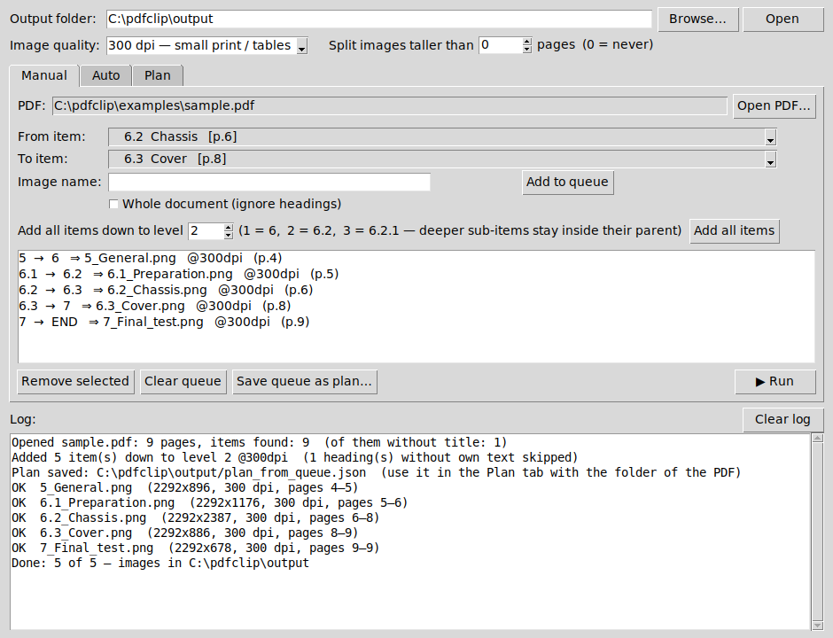
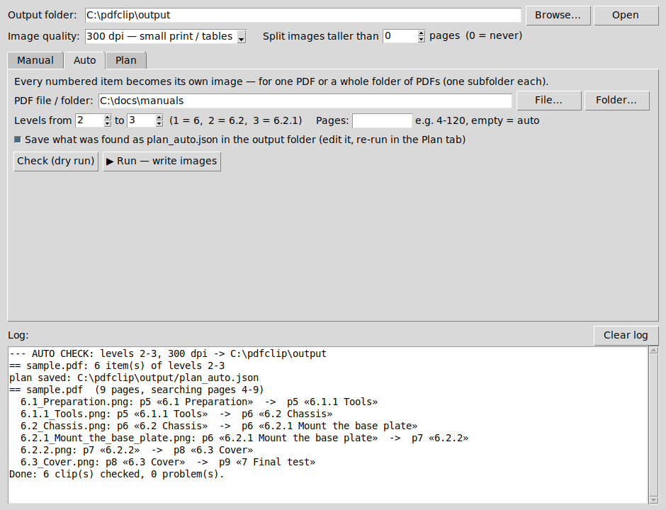
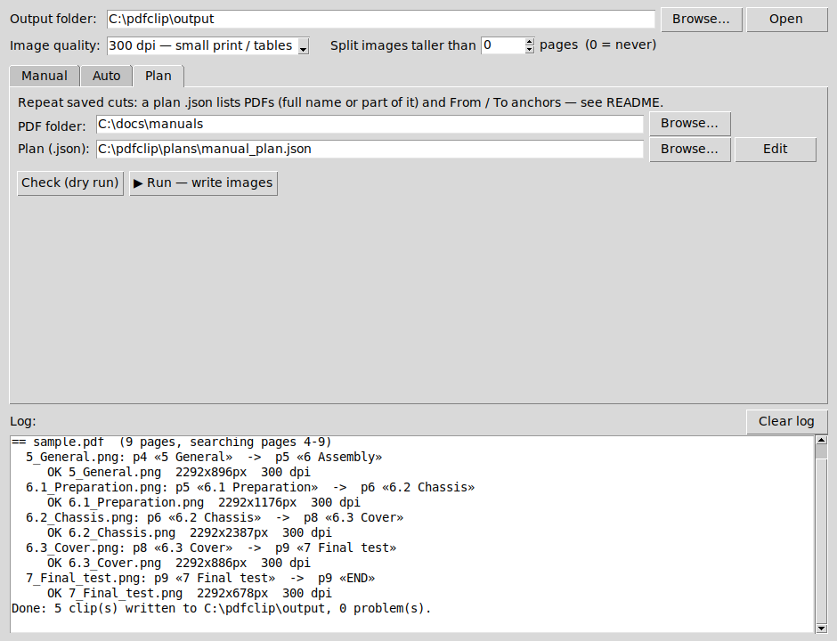

# PDF Clipper

Cut sections of a PDF (`6.2 Chassis` … up to `6.3`) into **clean PNG images** — text, tables and figures together,
with page headers, footers and blank page tails removed. Multi-page sections are stitched into one tall image
(or split into parts if you want).

Made for turning procedures, work instructions and test documents into images you can paste into
MES / route-card systems, wikis, tickets or slides — without screenshotting page by page.



## Features

- **Three ways to cut**
  - **Manual** — pick *From* / *To* items from the detected headings, or queue all of them in one click.
  - **Auto** — every numbered item of a PDF or of a **whole folder of PDFs** becomes its own image, nothing to pick.
  - **Plan** — repeat saved cuts from a `.json` plan every time a new document revision comes out.
- **Finds the document structure by itself** — numbered items and sub-items (`5`, `6.2`, `6.2.1` …), also bare
  numbers that have no title text. Numbered list steps (`7. Tighten the screws`), measured values (`6.3 V`), stray table
  numbers, `see 6.3` references and table-of-contents entries are filtered out.
- **Forgiving anchors** — `6.3. Power Supply Assembly` still finds the heading when the document has a different dash,
  extra spaces, a typo in a part number or the title broken over two lines. PDFs in a plan are found by part of the name
  (`"Assembly Instructions"` → `Product_X_Assembly_Instructions_R07.pdf`), so a new revision needs no plan change.
- **Clean output** — headers/footers, blank tails, grey side bands and Word review-comment margins are cut away
  automatically, or with fixed margins in mm if your template needs it.
- **Quality 150–1200 dpi**, optional splitting of very long sections into `name-1.png`, `name-2.png` …
- **Dry run** — *Check* shows which page and heading every cut starts and ends at, before anything is written.
- **Works offline** — only two libraries (PyMuPDF, Pillow), installable from a local `wheels` folder.

## Quick start

Needs **Python 3.10+** ([python.org](https://www.python.org/downloads/) — on Windows tick *Add python to PATH*).

**Windows:** download the release zip, unpack (e.g. to `C:\pdfclip`) and double-click **`run_gui.bat`**.
The first start creates a private environment (`venv`) in the folder and installs the two libraries.

**Any OS / manual:**

```bash
git clone https://github.com/AlexeyKoz/pdfclip.git
cd pdfclip
python -m venv venv
# Windows: venv\Scripts\activate     Linux/macOS: source venv/bin/activate
pip install -r requirements.txt
python clip_gui.py
```

Try it on `examples/sample.pdf` — a fake 9-page procedure with a table of contents, headers, footers, sub-items,
a bare number, a heading without its own text and a `6.3 V` value that must not be taken as a heading.

## The window

The top row is shared by all tabs: **output folder**, **image quality** and **split images taller than N pages**
(0 = always one image). The window remembers your folders and settings.

**Manual**
1. **Open PDF…** — headings are scanned automatically (page number in brackets).
2. Pick **From item**; **To item** fills itself with the next item of the same level (`6.2` → `6.3`, the sub-items
   `6.2.x` stay inside). The cut starts at *From* and stops right before *To*.
3. **Add to queue** (image name is optional), or **Add all items** down to a level. Headings with no text of their own
   (`6 Assembly` followed straight by `6.1`) are skipped.
4. **▶ Run**. **Save queue as plan…** keeps the queue as a `.json` to repeat it later in the *Plan* tab.

No numbered headings? Tick **Whole document**.

**Auto** — choose one PDF or a folder (each PDF gets its own subfolder), the levels (`1–2` = `6` and `6.2`,
`2–3` = `6.2` and `6.2.1`) and optionally a page range. **Check** first, then **Run**. With *Save what was found* the
result is also written as `plan_auto.json`: rename images or fix an anchor there and re-run it in the *Plan* tab.



**Plan** — choose the folder with the PDFs and the plan `.json`, **Check**, **Run**.



## Plans (`.json`)

```json
{
 "dpi": 300,
 "max_height_pt": 2526,
 "margins_mm": {"top": 18, "bottom": 15, "left": 8, "right": 8},
 "jobs": [
  { "pdf": "Assembly Instructions",
    "page_min": 4, "page_max": 120,
    "clips": [
     {"out": "Power_supply.png", "from": "6.3. Power Supply Assembly", "to": "NEXT"},
     {"out": "Wiring.png",       "from": "6.2",                        "to": "6.3"},
     {"out": "Final.png",        "from": {"text": "7", "page": 41},    "to": "END", "dpi": 200},
     {"out": "Second_note.png",  "from": {"text": "Note", "nth": 2},   "to": "NEXT"},
     {"out": "Everything.png",   "from": "ALL",                        "to": "END"}
    ] } ] }
```

| Key | Meaning |
|-----|---------|
| `pdf` | file name, or a part of it — looked up in the PDF folder |
| `from` | `6.2` (bare number, works without title text) · `6.3. Title` (number + title, fuzzy) · line start text · `ALL` · `^regex` |
| `to` | same as `from`, or `NEXT` (next item of the same or higher level) or `END` |
| `{"text": …, "page": N}` | only look on page N · `"nth": 2` = the 2nd occurrence |
| `dpi` | for the whole plan or one clip |
| `page_min` / `page_max` | page range to search (default: the first 3 pages are skipped in documents longer than 6 pages) |
| `max_height_pt` | split taller images into parts (842 pt ≈ one A4 page); omit = one image |
| `margins_mm` | fixed header/footer/side cut instead of automatic detection |
| `out` | image name; may contain a subfolder (`chapter6/6.2.png`) |

See `examples/sample_plan.json`.

## Batch mode (`jobs.txt`)

A simpler text format for the same thing. Put the PDFs into `input/`, the cuts into `jobs.txt`, run `run.bat`
(or `python clip_batch.py`):

```text
# file.pdf | from | to (or END / NEXT) | image name [| dpi]
dpi = 300
manual.pdf | 6.2          | 6.3  | Chassis
manual.pdf | 6.2.1        | NEXT | Base_plate
manual.pdf | 5. GENERAL   | 6.   | General     | 200
manual.pdf | 7            | END  | Final_test
manual.pdf | ALL          | END  | Whole_document
```

## Command line

```bash
python clip_batch.py                                   # jobs.txt
python clip_batch.py my_plan.json --docs C:\docs       # a plan
python clip_batch.py --auto C:\docs --depth 1-2 --save-plan plan_auto.json
python clip_batch.py plan.json --dry                   # only check
python clip_pdf.py manual.pdf 6.2 NEXT chassis.png --dpi 300
```

Options: `--out DIR`, `--dpi N`, `--dry`, `--only NAME.png`, `--pages 4-120` (auto), `--version`.

## Tips

- **Text still blurry at 600 dpi?** Usually the viewer shrinks a very tall image to fit the screen — cut at a deeper
  level or set *Split images taller than* 2–3 pages, and check the PNG at 100 % zoom. If the PDF itself contains a
  low-resolution scan, no dpi will make it sharper.
- **High dpi needs memory:** an A4 page at 1200 dpi is ~140 megapixels; keep long multi-page cuts at 300–600 dpi.
- **A heading is not found:** pages without a text layer (scans) cannot be searched — the log lists them. The first
  3 pages of long documents are treated as title/contents pages; set `page_min` (or *Pages* in Auto) to change that.
- **Your company footer is not removed?** Add its typical words to `FOOTER_RX` in `clip_pdf.py`, or use `margins_mm`.

## Offline / restricted PCs

See [docs/WINDOWS_OFFLINE.md](docs/WINDOWS_OFFLINE.md) — how to prepare a `wheels` folder and start the program
with copy-paste PowerShell/CMD commands when `.bat` files are blocked.

## Project files

| File | What it is |
|------|------------|
| `clip_gui.py` | the window: Manual / Auto / Plan tabs (tkinter, part of standard Python) |
| `clip_batch.py` | command line: `jobs.txt`, plans, `--auto` |
| `clip_pdf.py` | the engine: heading detection, anchors, header/footer removal, clipping |
| `run_gui.bat`, `run.bat` | Windows launchers (create `venv` on first start) |
| `examples/` | `sample.pdf`, `make_sample.py` that generates it, `sample_plan.json` |

## License

[MIT](LICENSE) © 2026 Alexey Kozlov
